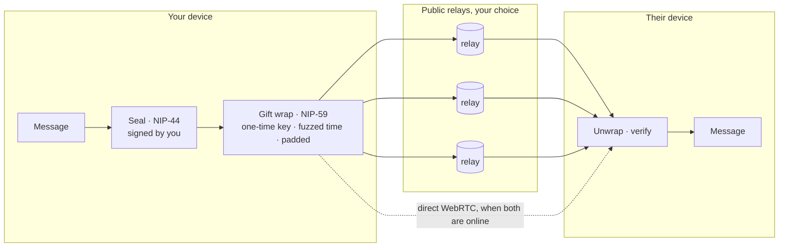
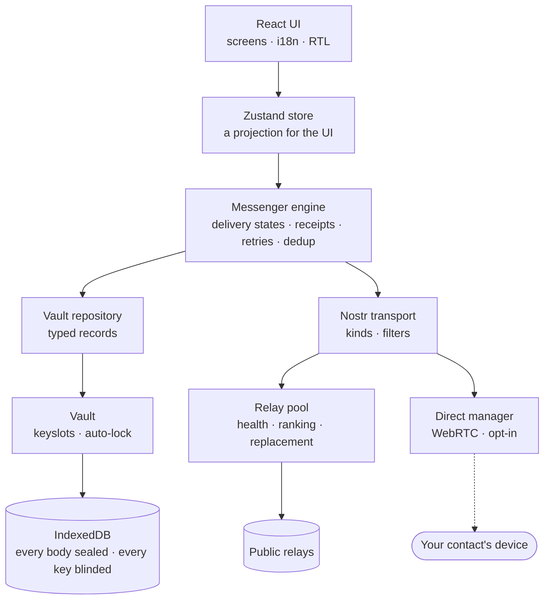
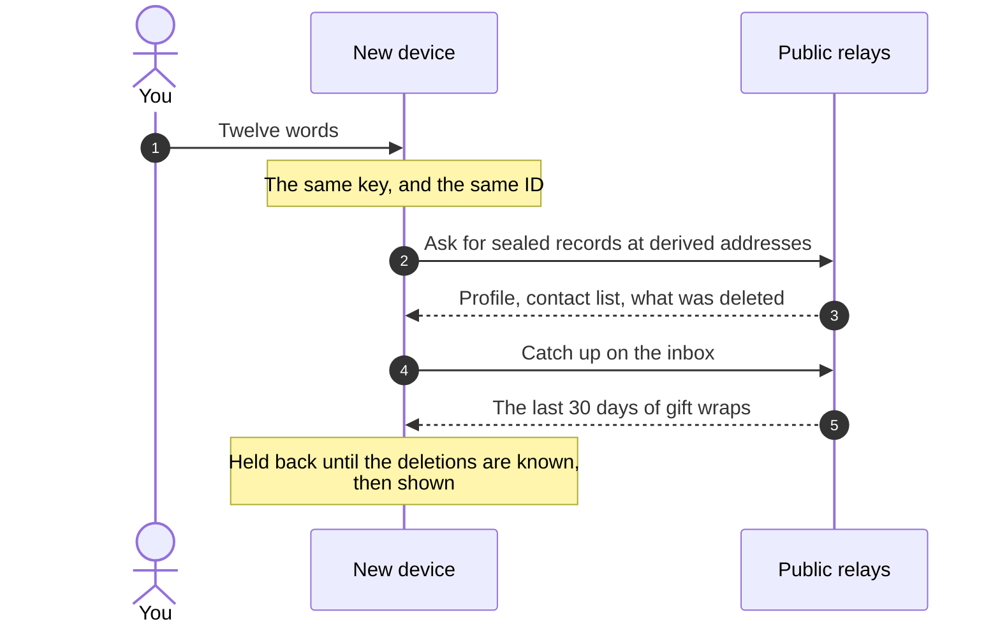

<div align="center">

<picture>
  <source media="(prefers-color-scheme: dark)" srcset="docs/assets/logo-dark.svg" />
  
</picture>

### A private messenger that is nothing but a web page.

No accounts. No phone numbers. No servers we operate. No analytics.<br />
End-to-end encrypted, carried by public Nostr relays, kept sealed on your own device.

[](https://github.com/Noormohammadiazad/Textor/actions)
[](https://noormohammadiazad.github.io/Textor/)
[](LICENSE)
[](docs/ARCHITECTURE.md#1-constraints)
[](docs/DECISIONS.md#adr-040--the-precache-is-a-budget-and-lazy-chunks-are-how-it-is-kept)
[](docs/THREAT-MODEL.md#5-how-to-check-these-claims)

**[Open Textor →](https://noormohammadiazad.github.io/Textor/)** &nbsp;·&nbsp; [How it works](#how-it-works) &nbsp;·&nbsp; [Security](#security-at-a-glance) &nbsp;·&nbsp; [Run your own](#run-your-own-copy) &nbsp;·&nbsp; [Documentation](#documentation)

</div>

---

Your identity is a key generated in your browser that never leaves it. Your messages are
encrypted before they touch the network, and everything is stored encrypted on your own
device. Textor is a static site: there is no Textor backend to compel, subpoena, breach or
shut down, because there isn't one.

## Why Textor

<table>
<tr>
<td width="33%" valign="top">

#### Zero setup

Open the page and you have an identity: a key made on your device, backed up as twelve
words. No sign-up, no phone number, no server to configure. Install it to your home screen
if you like; you don't have to.

</td>
<td width="33%" valign="top">

#### Private by default

Every message is sealed with NIP-44 and gift-wrapped with NIP-59 under a key made for that
message alone, its time fuzzed and its size padded. Relays hold ciphertext that does not
say who sent it.

</td>
<td width="33%" valign="top">

#### An ID you can read aloud

`7X9K2-M4QHD`: ten characters, 50 bits, worked out from your twelve words through
memory-hard scrypt. The same on every device, with no registry and nothing that expires.
It also makes every identity findable, [at a price](#honest-limitations).

</td>
</tr>
<tr>
<td valign="top">

#### Relay-agnostic

Any public Nostr relay that takes anonymous writes can carry your mail. Six ship as
defaults, four are held open each way, one that dies is replaced on evidence, and every
one of them is yours to change.

</td>
<td valign="top">

#### 1 MiB of media, with nobody online

Files, pictures and voice notes are sealed in 47.5 KiB XChaCha20-Poly1305 chunks and left
on relays at an address only someone holding the message can work out.

</td>
<td valign="top">

#### Cold restore, on any device

Twelve words on a new device bring back 30 days of messages, your profile, and your
contacts with their IDs, even with every other device lost. Nothing you deleted comes
back.

</td>
</tr>
</table>

## How it works

Your identity is a secp256k1 keypair derived from twelve words
([NIP-06](https://github.com/nostr-protocol/nips/blob/master/06.md)). A message is a
[NIP-17](https://github.com/nostr-protocol/nips/blob/master/17.md) private message: sealed
to its recipient and signed by you with
[NIP-44](https://github.com/nostr-protocol/nips/blob/master/44.md), then **gift-wrapped**
([NIP-59](https://github.com/nostr-protocol/nips/blob/master/59.md)) under a key made for
that wrap alone. The wrap goes to several public [Nostr](https://nostr.com) relays at once,
which act as dumb encrypted mailboxes over `wss://`. When both people are online, the app
also opens a direct WebRTC channel for instant delivery, still NIP-44 encrypted inside DTLS,
but every message still goes to relays, so nothing is lost to a dropped connection.



Relays are public infrastructure that anyone can run and that you can change at any time.
That is the point: no single party, including us, can stop the app working or read
anything.

| A relay sees                                     | A relay never sees                                    |
| ------------------------------------------------ | ----------------------------------------------------- |
| A gift wrap addressed to a public key            | The message                                           |
| A timestamp, randomised up to two days backwards | Who sent it: each wrap is signed by a key made for it |
| A size, rounded up to a padding bucket           | Whether two wraps came from the same person           |
| The IP address of whoever connects               | Names, contact lists, or who talks to whom            |

### Inside the browser



`src/core/` is free of any UI framework and runs in Node under test. The interface never
touches a transport or the database: it goes through the store, which goes through the
repository, which goes through the vault. The service worker holds the offline shell and
asks before it updates.

### A new device, from nothing

There is no server to restore from, so everything a new device needs is sealed on the
relays, at addresses only your key can work out.



After that, devices on one identity keep each other in step through sealed frames to
themselves: the contact list, the names you gave people, pins, reading, deleting, blocking
and answering calls.

## Features

**Messaging**

- **End-to-end encrypted, online or offline.** Messages wait on relays for 30 days, and one
  nobody has confirmed is sent again before it expires.
- **Delivery states you can trust:** queued → sent → delivered → read, each with a text label.
  One tick on its way, two only once read, and when each happened in the message's details.
- **Replies, reactions, drafts, copy, forward and select**, as Telegram handles a message: tap
  for its menu, hold to select. Either person may delete anything in a conversation for both,
  and the app says plainly that deleting for them is a request no one can enforce.
- **Files and voice notes up to 1 MiB** over relays, reaching someone who is offline; larger
  ones over a direct connection. Your other devices and everyone in a group read them from
  there, when they are wanted.
- **Polls and shared checklists**, sealed and counted on each device, with no tally server.
- **Locations and live location**, sealed like any message: a place, or where you are for
  15 minutes, an hour, eight hours or until you stop. The map is drawn on your device;
  streets from OpenStreetMap appear only if you turn them on, after it says what their
  servers see.

**Groups**

- **Small groups** of up to eight, as NIP-17 defines them: no group server, one sealed copy
  per member, and delivery tracked per person.
- **Forward-secret groups** of up to a hundred, using MLS in the
  [Marmot](https://github.com/marmot-protocol/marmot) format. Keys change with every change of
  members and at least weekly, and are deleted once used. Admins, a security code to compare,
  and text only. Loaded only by those who use them.

**Calls**

- **Voice and video, one to one:** mute, camera on and off, front and back camera, screen
  sharing. Signalled through sealed gift wraps shaped after NIP-AC and carried as DTLS-SRTP
  media, direct between your devices, with no account and nothing to set up. Someone who
  already runs a TURN server can add it in Settings.
- **Walkie-talkie**, from the conversation's header: push-to-talk over the same public relays,
  with no direct connection. It works where calls cannot, and neither side learns the other's
  IP address ([ADR-070](docs/DECISIONS.md)).

**Identity and devices**

- **An ID like `7X9K2-M4QHD`**, the same on every device. It is what you see of people, and a
  raw key only if you ask for one.
- **Contact exchange** by ID, QR code, invite link or `npub`, with no directory server, and
  **safety numbers** to confirm you have the right person's key.
- **Several devices on one identity**, kept in step with no server between them.
- **Encrypted export and import:** a backup opens with its own passphrase or with your recovery
  phrase, so a new device needs only the file and the twelve words.

**On your device**

- **An encrypted vault:** XChaCha20-Poly1305, blinded indexes, and LUKS-style keyslots. Open it
  with Touch ID, Face ID, Windows Hello, your phone's fingerprint or a FIDO2 security key (a
  key kept on the device, nothing in any cloud), a PIN or a pattern, a passphrase, or
  instantly, which is only ever the one way in. Each is labelled with what it protects
  against, and the twelve words open it whichever you chose.
- **An installable PWA that works offline** and installs in under 800 KiB. Everything else
  loads the first time it is used.
- **Persian and English**, full right-to-left, light and dark themes, and one layout from a
  320-pixel phone to a desktop window with the list beside the conversation.
- **A relay panel** with real per-relay delivery statistics and errors, verbatim.
- **No push notifications**, because that would need a server. Stated plainly, not hidden.

## Security at a glance

| Layer                 | What protects it                                                                                                                                |
| --------------------- | ----------------------------------------------------------------------------------------------------------------------------------------------- |
| Messages              | NIP-44 v2 inside NIP-59 gift wraps, a one-time signer per wrap, timestamps fuzzed by up to two days, sizes padded                               |
| Forward-secret groups | MLS ([RFC 9420](https://www.rfc-editor.org/rfc/rfc9420)) in Marmot's shapes; each message key deleted once used, every member renewed           |
| Calls                 | DTLS-SRTP, keyed through the sealed signalling; never kept                                                                                      |
| Files                 | XChaCha20-Poly1305 per chunk, bound to its file, index and count; the whole file's SHA-256 checked again after reassembly                       |
| Your device           | Every record sealed and bound to its table and row, HMAC-blinded index keys, keyslots; auto-lock drops the keys                                 |
| The page itself       | A strict Content-Security-Policy: `script-src 'self'`, no `eval`, no inline script, and one remote origin, for street-map images you opt into   |
| The build             | Reproducible from a commit, the SHA-256 of every deployed file published beside it, and CI that refuses a weakened policy or a third-party load |

Primitives come from the audited [`@noble`](https://github.com/paulmillr/noble-hashes)
libraries; nothing is rolled by hand. The [threat model](docs/THREAT-MODEL.md) is written to
be falsifiable: what each adversary can and cannot see, the limits, and how to
[check every claim yourself](docs/THREAT-MODEL.md#5-how-to-check-these-claims) in your
browser's developer tools.

## Compared

How Textor is built, next to messengers you may know.

|                                         | **Textor**                              | Signal         | WhatsApp       | Telegram                     | Matrix (Element)                   |
| --------------------------------------- | --------------------------------------- | -------------- | -------------- | ---------------------------- | ---------------------------------- |
| To sign up you need                     | Nothing: a key made on your device      | A phone number | A phone number | A phone number               | An account on a homeserver         |
| Servers in the path                     | Public relays you choose, run by anyone | Signal's       | Meta's         | Telegram's                   | Your homeserver and its federation |
| End-to-end encrypted by default         | ✅                                      | ✅             | ✅             | ❌ Secret Chats only, opt-in | ✅ private chats                   |
| Forward secrecy, one to one             | ❌ not yet; ✅ in forward-secret groups | ✅             | ✅             | Secret Chats only            | ✅                                 |
| Keeps working if its developer vanishes | ✅ static files, public relays          | ❌             | ❌             | ❌                           | ✅ federated                       |
| Run your own with no server             | ✅ any static host                      | ❌             | ❌             | ❌                           | ❌ needs a homeserver              |
| Push notifications                      | ❌ they need a server                   | ✅             | ✅             | ✅                           | ✅                                 |
| Open-source client                      | ✅                                      | ✅             | ❌             | ✅                           | ✅                                 |

<sub>Compared on how each is built, as each project describes itself at the time of writing,
late 2026. If something here is out of date, please say so in an issue.</sub>

## Honest limitations

A messenger that only lists its strengths is not being straight with you.

- **No forward secrecy for direct messages and small groups.** If your key is stolen
  _and_ an adversary kept old ciphertexts, they can read past messages. Wraps carry a
  30-day expiration request, and the protocol is versioned so a ratchet can land later.
  Forward-secret groups do not have this limit, but carry text only.
  ([ADR-003, ADR-049](docs/DECISIONS.md))
- **No push notifications.** They require an application server. Messages arrive when the
  app is open. ([ADR-007](docs/DECISIONS.md))
- **Direct connections and calls reveal your IP to your contact**, as any peer-to-peer
  connection does. Direct connections can be turned off, and calls can be forced through
  a TURN server you provide.
- **Calls need both people to have Textor open, and two networks that can meet.** Calls are
  direct, and Textor ships no relay, because none works without an account. Symmetric NAT on
  one side and a strict NAT on the other, or symmetric NAT on both, or a network blocking
  UDP, cannot connect a call. The screen says so, and the walkie-talkie still works: voice
  only, one way at a time. ([ADR-072](docs/DECISIONS.md))
- **Every device holds the same key, and one cannot be locked out.** Whoever has the
  recovery phrase is another of your devices. Settings says when another was last heard from.
  A forward-secret group lives only on the device that joined it. ([ADR-073](docs/DECISIONS.md))
- **Your twelve words also reveal who you know.** Your contact list is kept on relays, sealed,
  for up to a year, so that a restore can bring it back. Whoever gets the words can read it, long
  after every message has expired. Someone you remove is gone from it at once.
  ([ADR-078](docs/DECISIONS.md))
- **Every identity can be found by its ID.** A well-funded adversary who tries enough IDs can
  learn which keys use Textor, at a cost the ID's 50 bits and memory-hard function put in the
  millions of dollars for a full sweep. An ID is not verification: the safety number is.
  ([ADR-079](docs/DECISIONS.md))
- **Metadata is reduced, not eliminated.** Relays learn that a key receives mail, and
  roughly when. Anonymity against a global observer is not a goal.
- **Not independently audited.** The primitives are audited (`@noble/*`) and the protocol
  follows reviewed NIPs, but this application has not had a security review.
- **A malicious build would defeat everything.** Verify reproducible builds if that
  matters to you, or host your own.

## Run your own copy

Textor is designed to be forked and self-hosted; running your own copy is the strongest
answer to "why should I trust your build?". There are no secrets to set, no accounts to open
and no backend to configure.

### Try it locally

```bash
npm install
npm run dev
```

Open two browsers, or two ports so they get separate storage, create an identity in each,
and exchange invite links.

### Deploy to GitHub Pages

1. Fork this repository.
2. In **Settings → Pages**, set **Source** to **GitHub Actions**.
3. Push to `main`. The workflow typechecks, lints, checks formatting, runs the tests, audits
   the dependencies, builds, verifies the bundle, and deploys. A build that fails any of
   those is not deployed.
4. Nothing to configure for the base path. A project page served from `/<repo>/` and a
   user page served from `/` are both handled automatically, and CI fails the build if
   the manifest and the asset paths ever disagree. Link previews point at your own address
   by themselves.
5. **Custom domain (optional).** Add a repository variable `CUSTOM_DOMAIN` under
   _Settings → Secrets and variables → Actions → Variables_ with the hostname, and point
   your DNS at GitHub Pages. It is a variable rather than a committed `CNAME` file so
   forks do not inherit a domain they do not own — a committed `CNAME` would tell Pages
   to serve every fork at someone else's address and break their own URL.

The in-app "source code" link and crash-report hint point at your repository automatically,
so a fork never invites people to audit somebody else's code.

### Any other static host

```bash
npm run build
```

The output is a static `dist/` directory. Serve it from anywhere: any static host, a USB
stick, IPFS. Set `BASE_PATH` when it is served under a sub-path, and `SITE_URL` to the full
address it is served at if you want link previews with an image.

<details>
<summary><strong>Browser support</strong></summary>

<br />

| Browser              | Minimum |
| -------------------- | ------- |
| Chrome / Edge        | 108     |
| Firefox              | 110     |
| Safari (macOS / iOS) | 15.4    |

Required: IndexedDB, `crypto.getRandomValues`, WebSocket, `TextEncoder`. Everything else
degrades rather than blocking startup — WebRTC (falls back to relays), notifications,
the QR camera, backup compression, storage persistence, unlocking with biometrics
(WebAuthn user verification) and opening instantly (WebCrypto) are each feature-detected. If
a hard requirement is missing the app says which one instead of showing a blank page.

</details>

<details>
<summary><strong>After deploying</strong></summary>

<br />

Two things are worth checking once, on the live site:

- **Install it.** The app should offer to install; an installed PWA is also the state in
  which browsers most reliably grant persistent storage.
- **Open Settings → Data.** It states whether the browser has agreed to keep your vault.
  If it says it may delete your data, export an encrypted backup — there is no server
  copy to restore from.

</details>

### Verify

```bash
npm run verify        # typecheck, lint, format, tokens, tests with coverage
npm run build         # then: npm run check:bundle, for the policy, the precache and the link preview
npm run relays:probe  # check which public relays actually accept anonymous writes
```

## Documentation

| Document                                       | Contents                                                                        |
| ---------------------------------------------- | ------------------------------------------------------------------------------- |
| [`docs/ARCHITECTURE.md`](docs/ARCHITECTURE.md) | The system as built: constraints, layering, storage, delivery, deployment       |
| [`docs/PROTOCOL.md`](docs/PROTOCOL.md)         | Wire format, validation rules, delivery semantics, storage layout               |
| [`docs/DECISIONS.md`](docs/DECISIONS.md)       | Why each choice was made, including ones revised during implementation          |
| [`docs/THREAT-MODEL.md`](docs/THREAT-MODEL.md) | Adversaries, guarantees, limitations, and how to check them                     |
| [`docs/UI-PARITY.md`](docs/UI-PARITY.md)       | The conversation against Telegram Web's open-source clients, pattern by pattern |
| [`SECURITY.md`](SECURITY.md)                   | Reporting a vulnerability                                                       |
| [`CONTRIBUTING.md`](CONTRIBUTING.md)           | Development setup and standards                                                 |

## Built with

TypeScript · React 19 · Vite 8 · Dexie (IndexedDB) · Zustand · `nostr-tools` ·
`@noble/{ciphers,curves,hashes}` · `ts-mls` · `qr` · Workbox

Fourteen direct runtime dependencies, no CDN, no analytics, no tracking, no telemetry. Every
byte is served from the app's own origin under a strict Content-Security-Policy. The logo,
the icons and the link preview are drawn from one set of numbers by `npm run icons`, with no
image dependency and no font.

## Licence

[AGPL-3.0-or-later](LICENSE). If you run a modified version as a network service, you
must publish your changes — the point being that users of a privacy tool should always be
able to read the code they are actually running.
